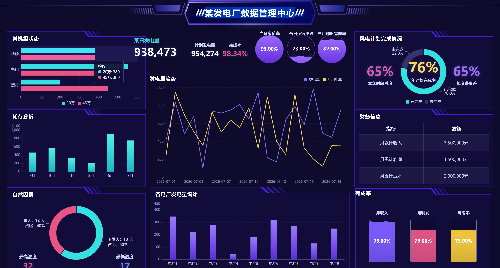
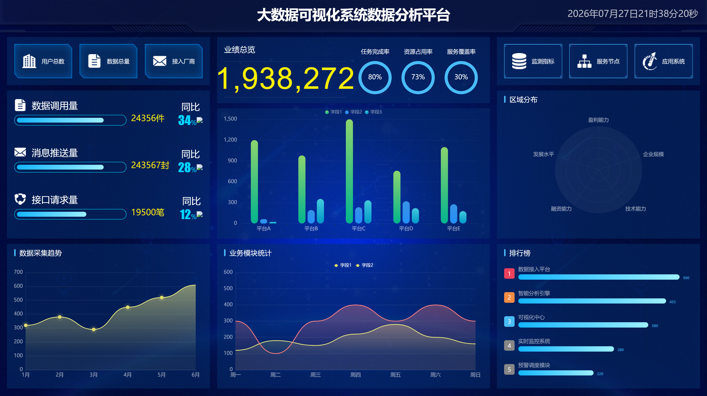
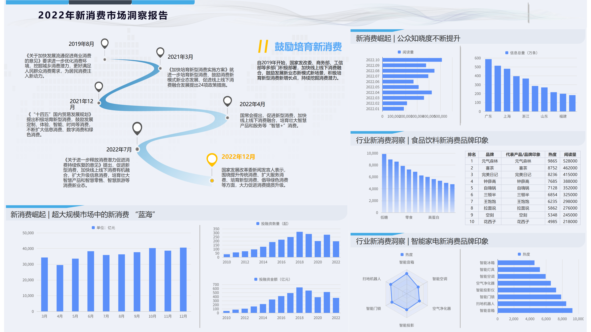
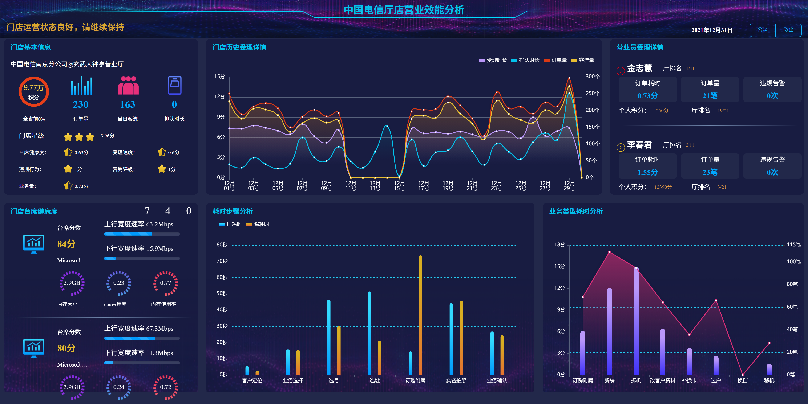

# 数字大屏生成器 (BigData Dashboard)

把 Excel / JSON 数据一键渲染成震撼、专业、可直接浏览器打开的**单文件 HTML 数据大屏**。无 CDN 依赖，CSS / JS / 图片全部内联，双击即可展示，便于离线分发与汇报投屏。

---

## 这个 Skill 用来干什么

- **数据可视化**：把表格数据转成 ECharts 驱动的统计卡片、柱/线/面积/饼/玫瑰/散点图、横向排行、表格、环形仪表等 9 类组件
- **行业模板**：内置 11 套已适配骨架（医药监管、智慧城市、发电厂、气象、设备监测、企业营收、信贷风控、电信门店、数据中心、电竞赛事、通用），开箱即用
- **双输入支持**：Excel（`.xlsx`）与 JSON 都可直接喂给构建脚本，Excel 自动识别三种结构
- **完全自包含**：产物单文件 HTML，体积通常 1–8 MB，可直接邮件 / U 盘分发
- **可扩展**：`assets/templates/custom/` 下放一个 `metadata.json` 即可定义自己的模板

---

## 如何触发

在 Claude Code 中直接说出意图即可，无需任何命令。常见触发说法：

- 「生成一个数据大屏」「做一个可视化大屏」「数字驾驶舱」「数据看板」
- 「帮我把这份 Excel 做成大屏」「把这些数据可视化」
- 「用医药模板生成大屏」「做一个电厂监控大屏」
- 提到「dashboard」「BI 大屏」「监控大屏」等关键词

Claude 会自动调用 **`bigdata-dashboard-expert`** 子智能体接管整个流程。

---

## 核心工作流程

### 标准三步（推荐，交互式）

```
① 选行业模板  →  ② 发数据模板让用户填  →  ③ 构建并预览
```

1. **选模板**：Claude 根据你的行业 / 场景，从 11 个内置模板中推荐最合适的一个并说明理由。
2. **准备数据**：
   - 你已有数据 → 直接发 `.xlsx` 或 `.json`，Claude 帮你转成模板需要的结构。
   - 你没数据 → Claude 把模板自带的 `example.json` / `example.xlsx` 发给你，告诉你「填 Excel 或 JSON 任一即可」，附字段映射说明。
3. **构建大屏**：执行 `py scripts/build_dashboard.py ...`，产出自包含 HTML，并自动在浏览器打开预览。

### 直接生成（用户已有 Excel / JSON）

跳过模板流程，一条命令直接出图：

```bash
py scripts/build_dashboard.py <你的数据>.xlsx --output dashboard.html
py scripts/build_dashboard.py <你的数据>.json --theme dark --output dashboard.html
```

### 指定模板生成（想要特定风格）

```bash
# 7 个自带源的模板：无需 --source-dir
py scripts/build_dashboard.py data.json --template skeleton_pharma --output out.html
py scripts/build_dashboard.py data.json --template skeleton_smart_city --output out.html
py scripts/build_dashboard.py data.json --template skeleton_power_plant --output out.html
py scripts/build_dashboard.py data.json --template skeleton_weather --output out.html
py scripts/build_dashboard.py data.json --template skeleton_lpl --output out.html
py scripts/build_dashboard.py data.json --template skeleton_generic --output out.html
py scripts/build_dashboard.py data.json --template skeleton_data_center --output out.html

# 其余 7 个模板：需要 --source-dir 指定原始 HTML 目录
py scripts/build_dashboard.py data.json --template skeleton_credit_risk --source-dir path/to/web/ --output out.html
```

### Excel ⇄ JSON 双向转换

```bash
# 由 example.json 生成可填写的 Excel 模板（多 sheet，含字段说明）
py scripts/make_xlsx_template.py assets/templates/data/skeleton_pharma/example.json user_data.xlsx

# 把填写好的 Excel 转回 JSON
py scripts/xlsx_to_json.py user_data.xlsx user_data.json

# 任意 Excel → JSON（自动三分支识别：模板回填 / legacy / 启发式）
py scripts/excel_to_json.py any.xlsx any.json
```

---

## 内置模板速查

| 模板名 | 适用场景 | 自带源 |
|---|---|---|
| `skeleton_pharma` | 药企监管、抽检、注册申请 | ✅ |
| `skeleton_power_plant` | 电厂、能源、机组监控 | ✅ |
| `skeleton_smart_city` | 城管、政务监管、实时告警 | ✅ |
| `skeleton_weather` | 气象、环境、水文监测 | ✅ |
| `skeleton_lpl` | 赛事、电竞、战队数据 | ✅ |
| `skeleton_generic` | 任意通用数据展示 | ✅ |
| `skeleton_data_center` | 数据中心、资源监控 | ✅ |
| `skeleton_revenue` | 营收、销售、业绩总览 | — |
| `skeleton_device_monitor` | IoT、机房、设备运维 | — |
| `skeleton_credit_risk` | 企业信用、风险预警 | — |
| `skeleton_telecom_store` | 营业厅、门店效能分析 | — |

> "自带源"指无需额外 `--source-dir` 即可直接构建；前 8 个模板（含 `weather` 等）带 `injector.js`，支持完整数据注入。

## 模板效果预览

以下为部分内置模板的渲染成品（截图来自 `examples/` 目录，双击产物 HTML 即可达同等效果）：

<table>
  <tr>
    <td width="50%" align="center"><br><sub><code>skeleton_pharma</code> · 药企监管、抽检、注册申请</sub></td>
    <td width="50%" align="center"><br><sub><code>skeleton_power_plant</code> · 电厂、能源、机组监控</sub></td>
  </tr>
  <tr>
    <td width="50%" align="center"><br><sub><code>skeleton_smart_city</code> · 城管、政务监管、实时告警</sub></td>
    <td width="50%" align="center"><br><sub><code>skeleton_generic</code> · 任意通用数据展示</sub></td>
  </tr>
  <tr>
    <td width="50%" align="center"><br><sub><code>skeleton_new_consumption</code> · 新消费市场洞察</sub></td>
    <td width="50%" align="center"><br><sub><code>skeleton_smart_dashboard</code> · 智能看板新中心</sub></td>
  </tr>
  <tr>
    <td colspan="2" align="center"><br><sub><code>skeleton_telecom_store</code> · 营业厅、门店效能分析</sub></td>
  </tr>
</table>

---

## 进一步阅读

- **`SKILL.md`** —— 完整权威说明书（构建流水线、数据契约、模板扩展体系）。**任何细节问题以它为准。**
- **`CLAUDE.md`** —— Claude Code 工程指南（架构、双目录模式、易踩点）。
- **`assets/templates/data/<skeleton>/README.md`** —— 每个模板的字段映射说明。
- **`assets/templates/custom/README.md`** —— 如何编写自定义模板。
- **`references/data_schema.md`** / **`references/layout_schema.md`** —— 数据格式与布局配置规范。

---

## 环境要求

- **Windows** + Python（通过 `py` launcher 调用）
- 浏览器（任何现代浏览器，用于预览产物）
- 无需额外服务端、无需联网（构建后产物完全离线可用）
